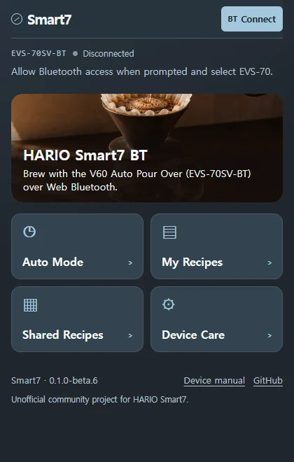
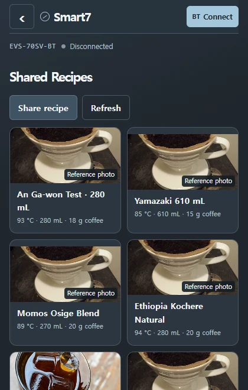
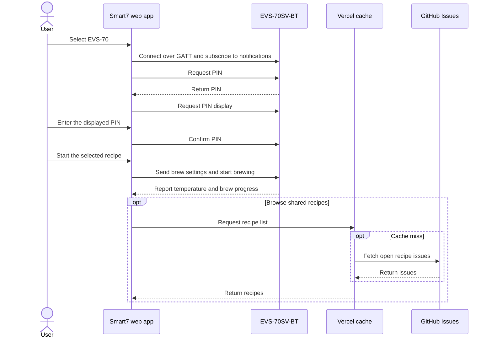

# HARIO Smart7 BT

**English** · [한국어](docs/README.ko.md) · [日本語](docs/README.ja.md)

[Open the web app](https://smart7-offline.vercel.app/) · [User manual (PDF)](https://smart7-offline.vercel.app/EVS-70SV-BT-manual.pdf) · [Recipe discussion](https://github.com/OneTop4458/HARIO-Smart7-BT/issues?q=is%3Aissue%20is%3Aopen%20label%3Arecipe)

[](https://github.com/OneTop4458/HARIO-Smart7-BT/actions/workflows/ci.yml)

An independent, open-source web app for the **HARIO V60 Auto Pour Over Smart7 BT (EVS-70SV-BT)**. Connect to the coffee maker with Web Bluetooth, control a brew, and save or share recipes.

| Home | Shared recipe library |
| --- | --- |
|  |  |

## Quick start

1. Open the web app over HTTPS in a browser that supports Web Bluetooth. If the app shows an unsupported-browser notice, try the latest Chrome on Android or a computer.
2. Turn on the brewer, select **BT Connect**, and choose **EVS-70** in the Bluetooth picker. Allow Bluetooth or Nearby devices access if prompted.
3. Enter the six-digit PIN shown on the brewer, then use **Auto Mode** or **My Recipes** to start a brew.

If the brewer is already connected to the HARIO app, disconnect it there and close that app before trying again. Smart7 retries a PIN request and can reconnect to the selected device when the brewer takes longer to respond.

## Recipes

- **My Recipes** stores brew settings and recipe photos in the browser. Use JSON to back up recipes or move them to another device.
- **Shared Recipes** contains archived Smart7 presets and recipes contributed through GitHub Issues. The app also supports browsing recipes on devices without Web Bluetooth.
- **Share Recipe** opens a GitHub issue draft. Add a photo to the issue's **Photo** section and keep translated recipe text in the same issue. Closing the issue hides it from the library after the cache refreshes.

## Architecture

The browser controls the brewer directly over Bluetooth. An installed app can open offline after its assets are cached, so the brewing controls and local recipes remain available. Shared recipes use the Vercel cache in front of the GitHub Issues API.



## Development

See the [HTTP API and recipe format](docs/api.md), [BLE protocol and Android APK analysis](docs/smart7-analysis.md), and [recipe sources](docs/recipe-sources.md).

```sh
npm test
python -m http.server 8080 --directory public
```

Open [localhost:8080](http://localhost:8080). The local static server reads public recipes directly from GitHub. GitHub Actions tests changes to pull requests and `main`, and Vercel deploys `main` after the build tests pass.

## License

The application code is available under the [MIT license](LICENSE). See [third-party notices](THIRD_PARTY_NOTICES.md) for the manual and reference photos.
