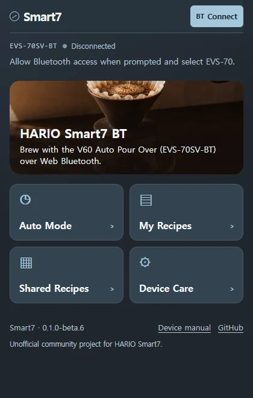
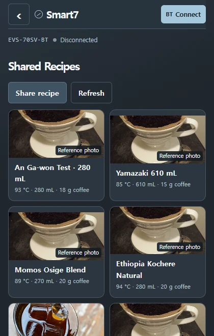
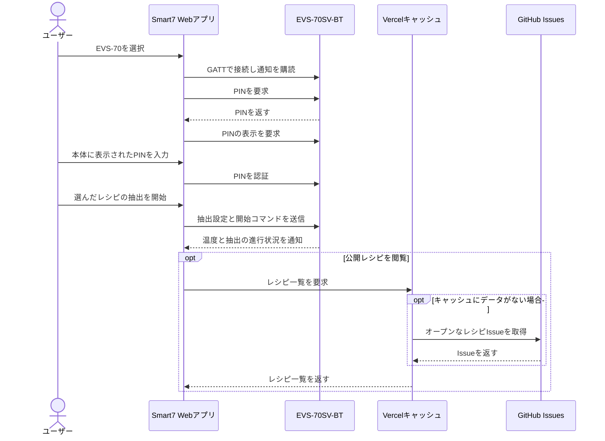

# HARIO Smart7 BT

[English](../README.md) · [한국어](README.ko.md) · **日本語**

[Webアプリを開く](https://smart7-offline.vercel.app/) · [取扱説明書 PDF](https://smart7-offline.vercel.app/EVS-70SV-BT-manual.pdf) · [公開レシピのIssue](https://github.com/OneTop4458/HARIO-Smart7-BT/issues?q=is%3Aissue%20is%3Aopen%20label%3Arecipe)

**HARIO V60オートプアオーバー Smart7 BT（EVS-70SV-BT）**向けの、コミュニティが開発するオープンソースのWebアプリです。Web Bluetoothで本体に接続し、抽出を操作したり、レシピを保存・共有したりできます。

| ホーム | 公開レシピ |
| --- | --- |
|  |  |

## はじめに

1. Web Bluetoothに対応したブラウザでHTTPSのWebアプリを開きます。非対応と表示された場合は、Androidまたはパソコンで最新版のChromeをお試しください。
2. 本体の電源を入れ、**BT 接続**を押して、デバイス選択画面で**EVS-70**を選びます。Bluetoothや**付近のデバイス**の権限を求められた場合は許可してください。
3. 本体に表示された6桁のPINを入力し、**オートモード**または**マイレシピ**から抽出を開始します。

HARIOのアプリが本体に接続中の場合は、そのアプリで接続を解除してから終了し、再試行してください。本体の応答が遅い場合、Smart7 WebアプリはPINの再要求や選択済みの機器への再接続を行います。

## レシピ

- **マイレシピ**では抽出設定と写真をブラウザに保存します。JSONでバックアップし、別の端末へ移せます。
- **公開レシピ**では、従来のSmart7レシピとGitHub Issueで共有されたレシピを閲覧できます。Web Bluetoothに非対応の端末でも閲覧できます。
- **レシピを共有**を押すとGitHub Issueの下書きが開きます。写真はIssueの**写真**欄に添付し、翻訳は同じIssueに追加します。Issueを閉じると、キャッシュの更新後に一覧から外れます。

## アーキテクチャ

ブラウザはBluetoothで本体を直接操作します。アプリのファイルがキャッシュされると、インストール済みのアプリはオフラインでも開け、抽出操作や保存済みのレシピを利用できます。公開レシピはVercelのキャッシュを経由してGitHub Issueから取得します。



## 開発

```sh
npm test
python -m http.server 8080 --directory public
```

[localhost:8080](http://localhost:8080)を開きます。ローカルの静的サーバーでは、公開レシピをGitHubから直接取得します。GitHub ActionsでPRと`main`への変更をテストし、Vercelでビルドテストに合格した`main`をデプロイします。

## ライセンス

アプリのコードは[MITライセンス](../LICENSE)です。説明書と参考写真の利用条件については[第三者資料に関する通知](../THIRD_PARTY_NOTICES.md)をご覧ください。
