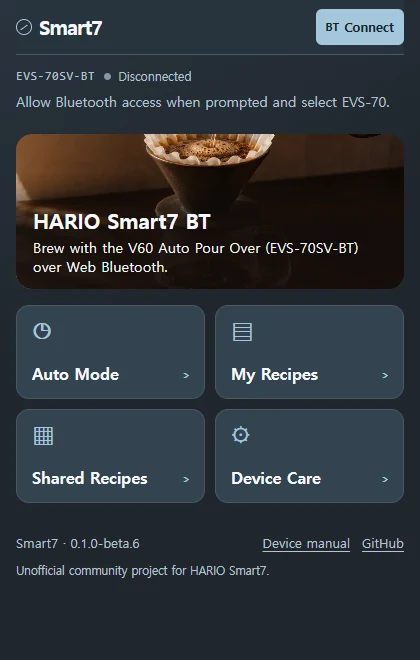
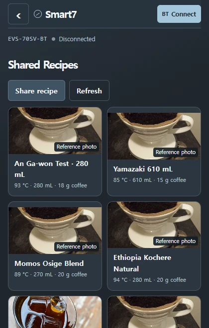
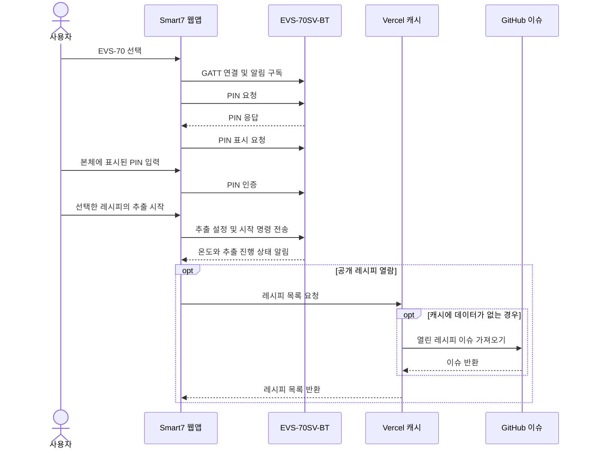

# HARIO Smart7 BT

[English](../README.md) · **한국어** · [日本語](README.ja.md)

[웹앱 열기](https://smart7-offline.vercel.app/) · [사용 설명서 PDF](https://smart7-offline.vercel.app/EVS-70SV-BT-manual.pdf) · [공유 레시피 이슈](https://github.com/OneTop4458/HARIO-Smart7-BT/issues?q=is%3Aissue%20is%3Aopen%20label%3Arecipe)

**하리오 V60 오토 푸어 오버 스마트7 BT(EVS-70SV-BT)**를 위한 독립 오픈 소스 웹앱입니다. Web Bluetooth로 본체를 연결해 추출하고 레시피를 저장하거나 공유할 수 있습니다.

| 홈 | 공개 레시피 |
| --- | --- |
|  |  |

## 시작하기

1. Web Bluetooth를 지원하는 브라우저에서 HTTPS 웹앱을 엽니다. 미지원 안내가 뜨면 Android나 컴퓨터에서 최신 Chrome을 사용하세요.
2. 본체 전원을 켜고 **BT 연결**을 누른 뒤 기기 선택창에서 **EVS-70**을 고릅니다. 권한 요청이 뜨면 블루투스 또는 **주변 기기** 권한을 허용합니다.
3. 본체에 표시된 6자리 PIN을 입력하고 **자동 모드** 또는 **내 레시피**에서 추출을 시작합니다.

하리오 앱이 이미 연결되어 있다면 그 앱에서 연결을 해제한 뒤 종료하고 다시 시도하세요. 본체 응답이 늦으면 Smart7 웹앱이 PIN을 다시 요청하고 선택한 기기에 재연결할 수 있습니다.

## 레시피

- **내 레시피**는 추출 설정과 사진을 브라우저에 저장합니다. JSON으로 백업하거나 다른 기기로 옮길 수 있습니다.
- **공개 레시피**에는 기존 Smart7 레시피와 GitHub 이슈로 올라온 레시피가 있습니다. Web Bluetooth를 지원하지 않는 기기에서도 열람할 수 있습니다.
- **레시피 공유**를 누르면 GitHub 이슈 초안이 열립니다. 사진은 이슈의 **사진** 항목에 첨부하고 번역은 같은 이슈에 담습니다. 이슈를 닫으면 캐시가 갱신된 뒤 목록에서 내려갑니다.

## 연결 구조

브라우저가 블루투스로 본체를 직접 제어합니다. 앱 파일을 받은 뒤에는 설치된 앱을 오프라인에서도 열어 추출하거나 저장한 레시피를 볼 수 있습니다. 공개 레시피는 Vercel 캐시를 거쳐 GitHub 이슈에서 가져옵니다.



## 개발

[HTTP API와 레시피 형식](api.md) · [BLE 프로토콜과 Android APK 분석](smart7-analysis.md) · [레시피 출처](recipe-sources.md)

```sh
npm test
python -m http.server 8080 --directory public
```

[localhost:8080](http://localhost:8080)에서 엽니다. 로컬 정적 서버에서는 GitHub에서 공개 레시피를 직접 읽습니다. GitHub Actions는 PR과 `main` 변경을 테스트하며, Vercel은 빌드 테스트를 통과한 `main`을 운영에 배포합니다.

## 라이선스

앱 코드는 [MIT 라이선스](../LICENSE)입니다. 설명서와 참고 사진의 이용 조건은 [제3자 자료 안내](../THIRD_PARTY_NOTICES.md)를 참고하세요.
